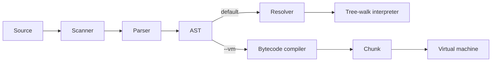

# Bytecode VM

## Why this exists

Litecode's complete runtime is the tree-walk interpreter. This directory is an
optional learning continuation: it explores how the same parsed program can be
compiled into instructions and run by a virtual machine. It is an alternative
backend, not an additional stage that the tree-walk interpreter uses, and it is
not a separate Git branch.

The goal is to keep the working interpreter stable while experimenting with a
different execution model. VM progress is therefore not required for the core
project to be complete.

The VM is not assumed to be faster or better today. Its value at this stage is
educational: it provides a place to explore the compiler/virtual-machine model
without destabilizing the complete interpreter.

## Where it fits

Both backends share source scanning, parsing, and AST construction. They split at
the AST:



The default command uses the tree-walk backend. To select the VM for a script:

```bash
./build/litecode --vm path/to/program.lox
```

`--bytecode` is an alias for `--vm`. The VM route starts after parsing and does
not run the resolver; the compiler performs its own limited local-name tracking.
In REPL mode, the driver constructs a fresh VM for each input batch, so globals
do not persist between VM REPL lines. The regular tree-walk REPL does preserve
state.

The VM sources are included in the normal CMake build. “Optional” describes the
runtime choice: the same `litecode` executable uses the tree-walk backend unless
the user passes `--vm` (or its `--bytecode` alias).

## What changes conceptually

For `print 1 + 2;`, the tree-walk interpreter visits the AST nodes at runtime:
it evaluates the left literal, evaluates the right literal, applies `+`, then
prints the result. The bytecode path first translates that AST into a sequence
similar to:

```text
Constant 1
Constant 2
Add
Print
```

The VM reads those instructions in order. `Constant` pushes values on an operand
stack, `Add` pops the two operands and pushes their sum, and `Print` consumes the
result. The extension is a different execution model: runtime work moves from
traversing syntax nodes to executing an instruction stream. Litecode's VM is a
small teaching implementation of that idea, not yet a complete or
performance-tuned alternative.

## Current capabilities

The compiler and VM currently support a bootstrap subset:

- nil, boolean, number, and string literals;
- arithmetic, selected comparisons, equality, and unary operators;
- global variables, assignments, and block-local slots;
- `if`, `while`, and the `for` form after parser desugaring;
- basic function declarations, calls, and returns.

The compiler does not yet emit logical operators, classes, properties,
inheritance, `this`, `super`, or closure capture. Some opcode values are reserved
for future work; those enum entries do not imply working feature support. The VM
also has no bytecode verifier, so it assumes chunks came from the current
compiler.

## How to read the implementation

- `Chunk.hpp` defines the instruction stream, constant pool, and function code object.
- `Compiler.cpp` translates supported AST forms into stack-oriented instructions.
- `VM.cpp` reads instructions and manipulates the operand stack, locals, and globals.
- `tests/unit/bytecode_test.cpp` and `tests/cases/bytecode_vm_basic/` exercise the supported path.

Read the compiler and VM together: emitted operand order and stack effects are a
contract between them. The tree-walk interpreter remains the reference behavior
for language features not yet covered by bytecode tests.
