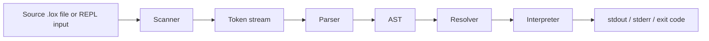

# Litecode Overview

Litecode is a learning-focused interpreter built in C++17 and inspired by the architecture in Crafting Interpreters. The project follows the classic pipeline of a language implementation:

- source text
- tokenization
- parsing into an AST
- lexical resolution
- runtime execution

The project is intentionally practical and readable. It is meant to be a working interpreter that can be explored layer by layer, while also serving as a solid training ground for compiler and runtime concepts.

## What the project does

Litecode supports a small but meaningful subset of the Lox language:

- literals: `nil`, booleans, numbers, strings
- arithmetic and comparison operators
- control flow: `if`, `else`, `while`, `for`
- variable declarations and block scoping
- functions, closures, recursion
- classes, instances, inheritance, `this`, and `super`
- native `clock()` function

This gives the project a real end-to-end language runtime rather than a partial lexer or parser toy.

## Product shape

The repo is organized around the standard pipeline for a tree-walk interpreter:

This is not just a parsing exercise; it is an end-to-end runtime system that can execute scripts and interactive inputs.

## Current maturity

The project is in a stable, working state for the tree-walk runtime. The current primary runtime path is the interpreter, while the bytecode VM remains an experimental secondary path.

That distinction matters:

- the stable interpreter is the product path
- the VM is an extension or bootstrap path
- correctness work belongs to the interpreter first
- VM work is optional feature growth beyond the baseline

Here, “optional” means that a user can select the VM with `--vm`; both backends
are compiled into the normal executable. They share scanning, parsing, and the
AST, then diverge: the default backend resolves and evaluates AST nodes directly,
while the VM backend compiles supported AST forms into instructions and executes
those instructions on a stack. The VM is an educational extension of the project,
not a dependency of the working interpreter and not a claim of better performance.
See the [Bytecode VM guide](../bytecode/README.md) for an example of how the two
execution models differ.

## Typical developer flow

The natural workflow is:

1. write or modify a `.lox` script
2. run it through the project binary
3. inspect errors or runtime behavior
4. add or update a regression test
5. validate with the project suite

## Documentation map

Use the docs in this order:

1. [1-overview.md](1-overview.md)
2. [2-architecture.md](2-architecture.md)
3. [3-language-reference.md](3-language-reference.md)
4. [4-runtime-and-execution.md](4-runtime-and-execution.md)
5. [5-developer-guide.md](5-developer-guide.md)
6. [6-testing-validation.md](6-testing-validation.md)
7. [7-roadmap-status.md](7-roadmap-status.md)

## Core mental model

The project is built around a very simple but important principle: each layer owns one job.

- the scanner owns text → tokens
- the parser owns tokens → AST
- the resolver owns scope and semantic validation
- the interpreter owns runtime evaluation
- the bytecode VM is a separate experimental execution path

This separation is the foundation for understanding the codebase.

## Essential concepts worth knowing

### Tokens and AST
The code does not execute raw text directly. It first converts the source into tokens and then into a syntax tree. That makes it possible to reason about the program structure before evaluating it.

### Environment and scope
The interpreter uses nested environments to model lexical scoping. Variables are resolved by walking outward through parent scopes rather than by global lookup alone.

### Callables and instances
Functions and classes are runtime values, not just syntax. They carry their own environment, method tables, and instance state.

### Resolution boundary
The resolver catches semantic errors before runtime. This is important because it distinguishes structural invalidity from behavior that only emerges during evaluation.

## Key principle

Litecode is intentionally structured to be understandable. The source code, docs, and tests all reinforce the same model: a small interpreter built in layers, not a monolithic runtime.
