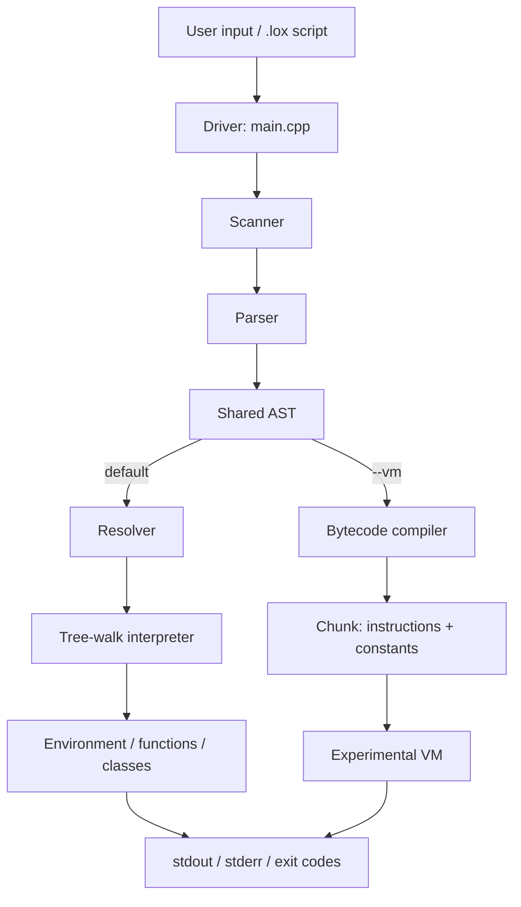
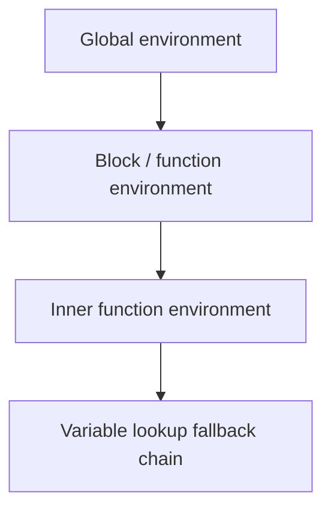

# Architecture Overview

Litecode is structured like a classic interpreter pipeline. Each layer has a clear responsibility and a narrow contract, which makes the system easier to reason about and extend.

## System-level view

The execution paths split **after parsing**. They are alternative backends, not
two stages in one runtime pipeline: the VM does not feed into or call the
tree-walk interpreter.

## Driver and entrypoints

The top-level entrypoint lives in [main.cpp](../main.cpp). It decides whether to:

- execute a file in script mode
- run an interactive REPL session
- use the bytecode VM path when selected

The CLI layer also handles:

- help/version output
- error exit codes
- environment-driven configuration

The `--vm`/`--bytecode` flag selects the experimental backend for a source batch.
Without it, execution follows the resolver plus tree-walk path.
Both backends are compiled into the normal executable; the flag selects which
one runs. It does not enable a separate build target or select a Git branch.

## Lexer and token stream

The scanner turns raw source into a stream of tokens. Each token contains metadata like:

- token type
- lexeme
- literal value if applicable
- source position

This is the boundary between freeform source text and structured language analysis.

## Parser and AST

The parser consumes tokens and emits a syntax tree. The AST is composed of expression and statement nodes, including:

- `Binary`, `Unary`, `Grouping`, `Literal`
- `Variable`, `Assign`
- `Call`, `Get`, `Set`
- `FunctionStmt`, `ReturnStmt`
- `ClassStmt`, `This`, `Super`

This layer is where grammar becomes structured program representation.

## Resolver

The resolver does static checks before evaluation. It answers questions like:

- is this variable defined?
- is this a valid `return` site?
- is `this` used inside a class?
- is `super` used correctly?
- are there duplicate locals?

This is the layer that enforces lexical validity and scope rules before the runtime executes code.

## Runtime interpreter

The interpreter evaluates the resolved AST. It owns:

- the active environment chain
- global storage
- function calls
- closure handling
- instance and class behavior

The most important runtime objects are:

- `Environment` for lexical scope
- `Interpreter` for expression evaluation and statement execution
- `LoxCallable` and LoxFunction for call semantics
- `LoxClass` and `LoxInstance` for object model behavior

## Environment model

Environments are nested and form the lexical scope chain.

When a variable lookup fails in the current scope, it walks outward through the parent environment chain. This is the mechanism behind closures and lexical scoping.

## Bytecode bootstrap path

The project contains a bytecode compiler and VM bootstrap layer under
[bytecode](../bytecode). “Separate branch” here means a separate backend in the
program architecture, not a separate Git branch. It exists as a learning
continuation: it lets the project explore the next execution model after the
working tree-walk interpreter without making the interpreter depend on unfinished
VM work.

The two backends share the scanner, parser, and AST, then diverge:

- tree-walk: AST → resolver → interpreter; this is the complete, authoritative runtime;
- bytecode: AST → compiler → chunk → VM; this is experimental and skips the resolver.

The bytecode compiler currently covers core literals, arithmetic/comparison,
variables, block locals, conditional/loop control flow, and basic function
declaration/call behavior. It does not yet provide parity for logical operators,
closures, classes, properties, `this`, or `super`. Opcode names for some of those
features are reserved, but the presence of an opcode does not mean the compiler
and VM implement it.

The bytecode route is selected with `litecode --vm script.lox`. In REPL mode a
fresh VM is constructed per input batch, so VM globals do not persist from one
line to the next. The standard tree-walk REPL remains stateful and is the route to
use for the complete language behavior.

The design intent is:

- tree-walk interpreter stays authoritative
- bytecode VM is an experimental alternative backend and learning track
- project maturity does not depend on VM parity for completion

## Core runtime objects

The most important runtime abstractions are:

- `Token`: lexical unit with type and lexeme
- `Expr` and `Stmt`: AST nodes describing program structure
- `Environment`: scope chain and variable storage
- `Interpreter`: evaluator that executes statements and expressions
- `LoxCallable` / `LoxFunction`: callable runtime values
- `LoxClass` / `LoxInstance`: class and object behavior

These objects are the heart of the language implementation. Understanding how they relate is the key to understanding the runtime.

## Architectural takeaway

The real design strength of Litecode is its separation of concerns:

- scanner: lexing
- parser: syntax
- resolver: semantics and scope
- interpreter: runtime behavior
- bytecode: experimental VM path

That is a typical and healthy interpreter architecture for a project of this size.
