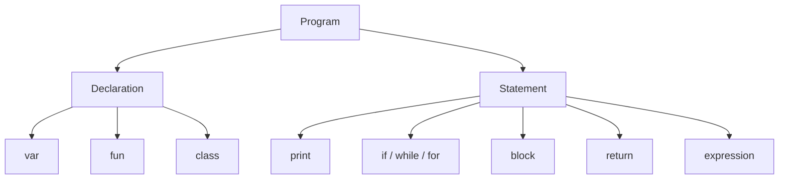

# Language Reference

Litecode implements a compact Lox-style language designed for teaching and experimentation. The syntax is deliberately small but expressive enough to cover functions, closures, and classes.

## Lexical basics

The language supports:

- keywords such as `var`, `fun`, `class`, `return`, `if`, `while`, `for`, `else`
- numbers, strings, `true`, `false`, and `nil`
- operators for arithmetic, comparison, equality, logic, and assignment
- comments and whitespace handling in the scanner

## Grammar overview



## Core syntax examples

### Variables and expressions

```lox
var x = 10;
var y = x + 5;
print y;
```

### Control flow

```lox
if (x > 0) {
  print "positive";
} else {
  print "non-positive";
}
```

### Functions and closures

```lox
fun add(a, b) {
  return a + b;
}

print add(2, 3);
```

Closures work by capturing the lexical environment of the defining scope, so nested functions can still access outer variables.

### Classes and instances

```lox
class Person {
  init(name) {
    this.name = name;
  }

  greet() {
    return "Hi, " + this.name;
  }
}

var p = Person("Ada");
print p.greet();
```

## Semantics and behavior

### Scoping

Litecode uses lexical scoping. Inner blocks and functions can read outer bindings, but variable shadowing obeys the resolution rules enforced by the resolver.

### Truthiness

The language follows a standard Lox-style truthiness model:

- `false` and `nil` are falsey
- everything else is truthy

### Equality and comparison

The runtime supports:

- equality: `==`, `!=`
- comparisons: `<`, `<=`, `>`, `>=`
- arithmetic: `+`, `-`, `*`, `/`
- unary: `!`, `-`

### Functions

- functions are first-class values in the runtime
- they can be assigned to variables and passed around
- arity is checked at call time
- return statements exit the current function frame

### Classes

Classes support:

- instance fields
- methods
- constructor-like `init`
- inheritance via `<`
- `this` binding inside instance methods
- `super` dispatch in subclasses

## Error model

The language follows a readable diagnostic model:

- lexing errors
- parser errors
- resolver errors
- runtime errors

Each error path maps to a specific shell exit code and stderr message.

## Learning note

This language is intentionally compact and readable because it is meant to teach core interpreter structure rather than emulate a production language runtime.
