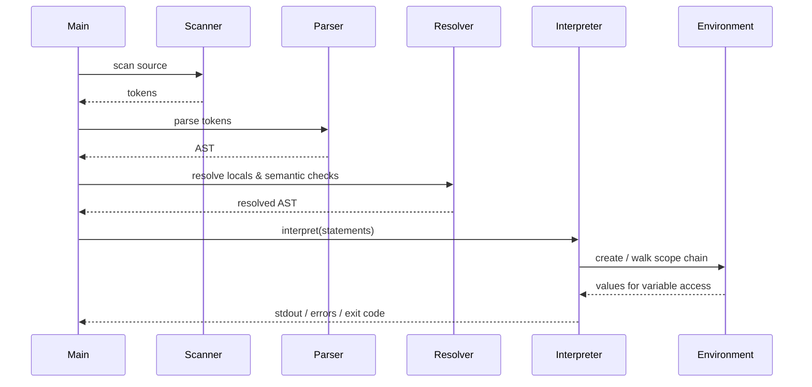
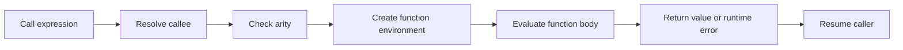
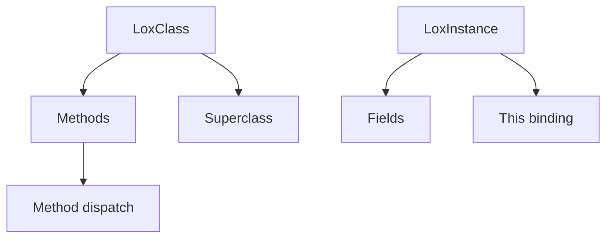

# Runtime and Execution Flow

This document follows the path from source text to runtime behavior. It is the best place to understand how the interpreter actually executes code once parsing and resolution are done.

## Execution sequence



## Top-level interpreter loop

The interpreter executes statements in order and evaluates expressions recursively. The runtime is intentionally simple and direct:

```cpp
for (const auto& stmt : statements) {
    if (stmt) execute(*stmt);
}
```

This pattern appears in the project’s runtime execution model and it is the core of the tree-walk evaluator.

## Statement execution

The runtime handles many statement types, including:

- `print`
- variable declarations
- blocks
- `if` / `else`
- `while`
- `for`
- functions
- returns
- classes

The dispatcher pattern is straightforward: each statement type is matched and handled in a dedicated branch.

## Environment and scope

The runtime uses nested environments to model lexical scopes. A block or function introduces a new environment, and variable resolution walks outward through the parent chain.

```cpp
Value Environment::get(const lexer::Token& name) const {
    auto it = values.find(name.getLexeme());
    if (it != values.end()) {
        return it->second;
    }

    if (enclosing) {
        return enclosing->get(name);
    }

    throw RuntimeError(name, "Undefined variable '" + name.getLexeme() + "'.");
}
```

This is the core mechanism behind closures and nested scopes.

## Function execution

Function declarations are stored as callable objects and bound to the current environment. A function call evaluates arguments, creates a call frame, and executes the function body with the current lexical environment captured.



The project’s function semantics support:

- recursion
- nested function declarations
- closure capture of outer variables
- return propagation

## Classes and instances

The runtime creates class objects and instance objects and stores methods and fields in the object model.



This is how the language supports object behavior, inheritance, and `this` resolution.

## Error handling model

Runtime errors are surfaced as structured errors and translated into the project’s process exit model.

- language errors use exit code `65`
- file IO errors use exit code `66`
- this matches the CLI and test expectations

## Value model and evaluation

Litecode does not execute source directly. It evaluates a typed runtime value model. A value may be:

- `nil`
- boolean
- number
- string
- callable
- instance

The project uses a `std::variant`-style value representation internally, and evaluation functions branch over expression types to produce those runtime values.

## The execution boundary

The two key functions are:

- `Interpreter::execute` for statements
- `Interpreter::evaluate` for expressions

This split is important because statements mutate state, while expressions produce values.

## Function call semantics in practice

A call is not just syntax sugar; it performs several important steps:

1. resolve the callee
2. check that it is callable
3. verify the arity
4. create a new environment for the call
5. bind parameters and local state
6. execute the function body
7. return or propagate an error

This is what makes closures and recursion possible.

## Return propagation and unwinding

The interpreter uses a control-flow signal for function returns. That lets the runtime unwind the current call stack without mixing return logic into unrelated evaluation. It also preserves the distinction between:

- normal value return
- top-level invalid `return`
- runtime error

## Runtime summary

The runtime is intentionally clear:

- `Interpreter::execute` dispatches on statement type
- `Interpreter::evaluate` dispatches on expression type
- `Environment` handles scope and variable lookup
- `LoxCallable` / `LoxFunction` model function semantics
- `LoxClass` / `LoxInstance` model class behavior

This is the central mental model to keep when reading the runtime implementation.
