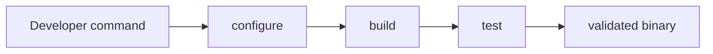

# Developer Guide

This guide covers how to build, run, validate, and debug Litecode in a normal development workflow.

## Repository layout

```text
litecode/
  lexer/          # scanner and tokens
  parser/         # AST and parser
  resolver/       # semantic checks and scope binding
  interpreter/    # tree-walk runtime
  bytecode/       # experimental AST-to-bytecode execution backend
  tests/          # unit tests and case fixtures
  scripts/        # automation helpers
  docs/           # project documentation
  main.cpp        # CLI and REPL entrypoint
  CMakeLists.txt  # build configuration
```

## Build options

The project supports a few practical build modes.

### Standard build

```bash
./scripts/build.sh default
```

This creates a normal release-oriented build in `build`.

### Sanitizer build

```bash
./scripts/build.sh asan
```

This creates a separate `build-asan` directory with AddressSanitizer flags enabled. This is the preferred memory-debugging path for the project.

### Clean rebuild

```bash
./scripts/build.sh clean
```

This strips generated build directories so a fresh configuration can begin from scratch.

### Optional leak checks

```bash
./scripts/build.sh leak
```

This uses:

- `valgrind` on Linux if installed
- `leaks` on macOS if installed

These checks are useful for deeper diagnostics, but they should be treated as advisory rather than a hard gate for product completion.

## Build flow



## Running the interpreter

### File mode

```bash
./build/litecode path/to/script.lox
```

### REPL mode

```bash
./build/litecode
```

### Experimental VM backend

```bash
./build/litecode --vm path/to/script.lox
```

The VM is selected per invocation and is already part of the normal executable.
It shares scanning/parsing with the default interpreter but skips resolution and
supports only a subset of the language. Its REPL creates a fresh VM for every
input batch, unlike the stateful default REPL. See [the bytecode guide](../bytecode/README.md)
for its supported features and current limitations.

Common REPL commands:

- `.help`
- `.reset`
- `.quit`

## Debug controls

```bash
env LITECODE_DUMP_TOKENS=1 ./build/litecode sample.lox
env LITECODE_DUMP_AST=1 ./build/litecode sample.lox
```

These environment variables help inspect the intermediary stages without changing the language semantics.

## Recommended workflow

For normal development, the best flow is:

1. run `./scripts/build.sh default`
2. run focused tests or the smoke script
3. use `./scripts/build.sh asan test` when investigating memory issues
4. keep the default build as the main validation path

## Practical advice

- keep build outputs separate between standard and sanitizer builds
- prefer ASan for routine debugging
- use leak tools only when a specific memory investigation is needed
- treat the interpreter as the product path and the bytecode VM as a separate experimental track
