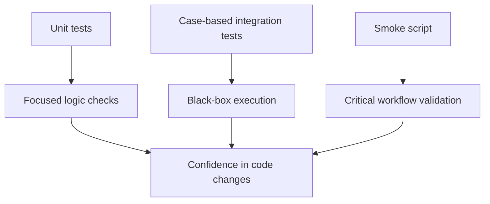

# Testing and Validation

The project uses a layered validation strategy. This helps combine fast, focused checks with end-to-end product verification.

## Testing model



## Unit tests

The unit tests are built with GoogleTest and cover the core logic of each subsystem:

- scanner behavior
- parser/resolver constraints
- interpreter semantics
- environment and scope behavior
- bytecode VM bootstrap checks

These tests are fast and useful for local debugging.

## Case-based tests

The repo also contains case directories under [tests/cases](../tests/cases). Each case includes:

- input source
- expected stdout
- expected stderr
- expected exit code

This gives the project deterministic, end-to-end checks for common runtime scenarios.

Run one registered integration case by its CTest name:

```bash
ctest --test-dir build --output-on-failure -R 'tests.cases.runtime_arithmetic'
```

Each case directory contains `input.lox`, `expected.out`, `expected.err`, and
`expected.exit`. CMake registers each directory as `tests.cases.<case_name>`.
After adding a new directory, reconfigure and rebuild so CMake discovers it,
then run CTest.

The shared runner can also be invoked directly:

```bash
./tests/run_case.sh ./build/litecode tests/cases/runtime_arithmetic
```

It executes the case input and compares stdout, stderr, and exit code against
the expected files. To run a case through the experimental bytecode VM, specify
the mode:

```bash
./tests/run_case.sh ./build/litecode --vm tests/cases/bytecode_vm_basic
```

For CTest-discovered VM cases, put `--vm` in a `mode` file in the case
directory; a non-empty mode file overrides the optional runner argument.

## Smoke script

The smoke script runs a broad set of real product flows without depending on the human to manually craft each test.

It checks:

- valid execution
- syntax and runtime failures
- file-open errors
- debug toggles
- function and closure behavior
- class and inheritance behavior
- REPL reset semantics

## Standard validation commands

```bash
ctest --test-dir build --output-on-failure
./scripts/regression_smoke.sh ./build/litecode
```

## Sanitizer validation

```bash
./scripts/build.sh asan test
```

This is the recommended memory-safety check for the project.

## Adding a regression

When changing behavior, add one of the following:

1. a focused unit test for the exact subsystem behavior
2. an end-to-end case for full runtime validation
3. a smoke check for a user-visible workflow

This keeps the repo useful as the language grows and keeps regressions visible before they affect the product.

## Validation principle

The project values confidence through real behavior, not mock-only tests. The most important proof is that the interpreter executes actual Lox programs correctly and exits with the expected status.
