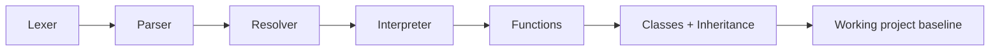

# Roadmap and Status

This document is intentionally concise and outcome-oriented. It summarizes what is complete, what is still experimental, and what the project is likely to do next.

## Current status

The project is functionally complete for the current tree-walk interpreter scope.

The stable runtime includes:

- scanning and tokenization
- parsing and AST creation
- static resolution and semantic checks
- execution of expressions and statements
- closures, recursion, and functions
- classes, inheritance, `this`, and `super`
- REPL integration and script execution

## Completed milestone view

This means the project already reaches a real, working end-to-end baseline.

## Experimental path

The bytecode VM under [bytecode](../bytecode) is an experimental alternative backend, not a separate Git branch or a stage used by the tree-walk interpreter. It shares the scanner, parser, and AST, then compiles supported AST forms into bytecode. The normal executable includes it, but users must select it with `--vm`. It is useful as a learning continuation, but its current feature subset is not required to finish the primary interpreter project.

## Current gap assessment

The important gaps are not correctness gaps in the interpreter. They are optional product and engineering improvements, such as:

- better documentation polish
- additional validation cases
- deeper runtime optimization
- continued VM feature work as an experimental backend

## Recommended next steps

### Near term

- tighten documentation and examples
- add more edge-case test coverage
- keep build automation clear and repeatable

### Longer term

- deepen the bytecode VM bootstrap as a research continuation
- improve runtime ergonomics and diagnostics
- decide whether the VM should remain experimental or become a real alternative runtime

## Project conclusion

The project has already crossed the point where the main interpreter is working and validated. The remaining work is mostly product polish or optional architecture expansion, not bug-fixing for the core language implementation.
